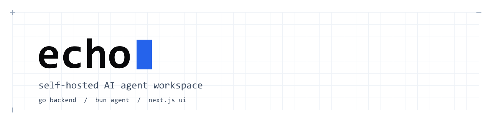
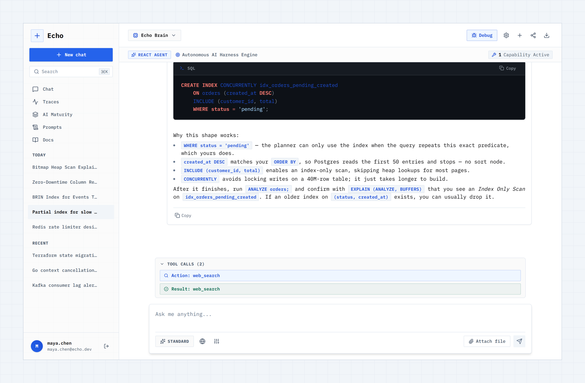
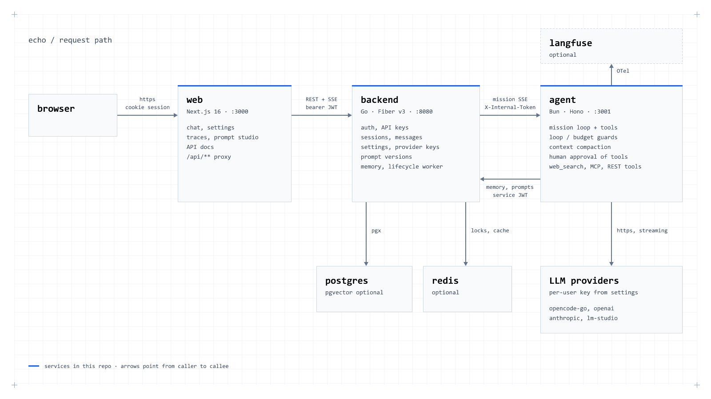
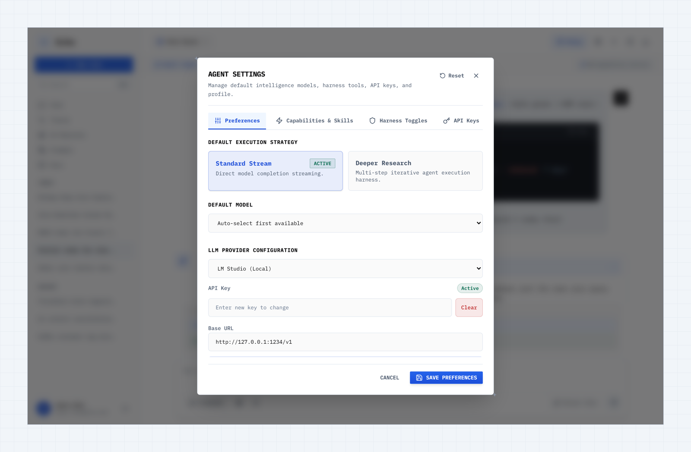
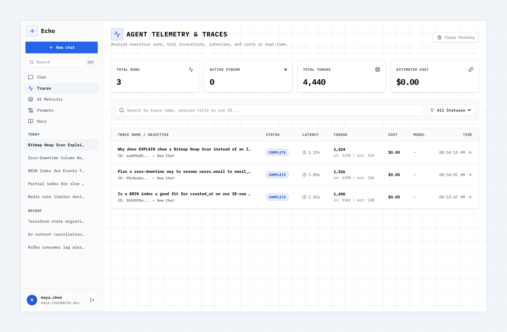
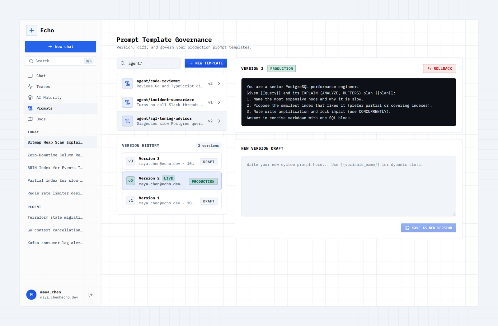
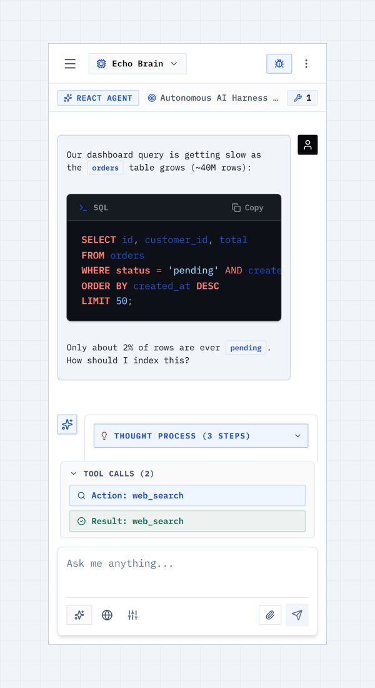

<picture>
  <source media="(prefers-color-scheme: dark)" srcset="docs/assets/readme/banner-dark.png">
  
</picture>

Echo is a self-hosted chat and agent workspace. You bring your own model provider key (OpenAI, Anthropic, opencode-go or a local LM Studio), and Echo runs a tool-using agent loop against it. Answers stream in as the agent works, and tool calls marked as protected wait for your approval before they run.

It is three services in one repo: a Next.js UI, a Go API that owns users, sessions and settings, and a Bun agent service that runs the model loop.

<picture>
  <source media="(prefers-color-scheme: dark)" srcset="docs/assets/screenshots/chat-dark.png">
  
</picture>

## How it fits together

<picture>
  <source media="(prefers-color-scheme: dark)" srcset="docs/assets/readme/architecture-dark.png">
  
</picture>

**web** (`app/web`, Next.js 16). The browser never calls the backend directly. Every request goes through route handlers under `src/app/api/**`, which keep the JWT in an httpOnly cookie and forward it as a bearer token. Chat responses come back as SSE and are rendered as they arrive.

**backend** (`backend`, Go + Fiber v3). Handles auth (JWT, refresh-token rotation, user API keys), sessions and messages, per-user settings with provider keys encrypted at rest, versioned system prompts, and a small memory API. A background worker summarises long sessions and prunes old turns. The schema lives in `internal/database/schema.go` and is applied on startup.

**agent** (`agent`, Bun + Hono). Receives one mission per chat turn from the backend and streams events back. The loop has guards for repeated tool calls, cost and step budgets, context compaction, and a human-approval step for protected tools. Built-in tools are `web_search`, `write_todos` and `delegate_task`. MCP tools can be added with `ENABLE_MCP` and `MCP_SERVER_URL`. It calls back into the backend for memory and prompts with a short-lived service JWT.

Postgres is required. Redis is only used for locks and caching: set `REDIS_ADDR=` (empty) in `backend/.env` to run without it, and the agent just logs a warning. Langfuse tracing is optional.

## Running it locally

You need Docker, Go 1.25+, Bun 1.4+ and `make` (on Windows, from scoop or choco). The repo scripts and the pre-commit hook also call a few Go tools:

```bash
go install gotest.tools/gotestsum@latest
go install mvdan.cc/gofumpt@latest
go install github.com/golangci/golangci-lint/v2/cmd/golangci-lint@latest
go install github.com/air-verse/air@latest   # only for `bun run dev`
```

Then:

```bash
bun install

cp backend/.env.example backend/.env
cp agent/.env.example agent/.env
```

The example files work as they are for local use: `INTERNAL_AUTH_TOKEN` and `SERVICE_JWT_SECRET` already match between the two. If you change one, change it in both files. Add a line `ADMIN_PASSWORD=<something>` to `backend/.env` for the seed step below.

Anything that is not your laptop needs real values for `JWT_SECRET`, `INTERNAL_AUTH_TOKEN`, `SERVICE_JWT_SECRET` and a 32-character `ENCRYPTION_KEY`. With `ENVIRONMENT=production` the backend refuses the example placeholders.

Start Postgres and Redis in Docker and the three services on the host:

```bash
make dev-echo
```

The backend creates its tables on start. On the very first run Postgres may still be initialising when the backend connects; if the backend exits, run `make dev-echo` again.

In another terminal, create the admin user:

```bash
cd backend
go run ./cmd/db/seed
```

Sign in at http://localhost:3000 as `admin@gmail.com` with the `ADMIN_PASSWORD` you set. Running the seed again does not change an existing password. There is no sign-up page yet. Open Settings, pick a provider and paste your API key; LM Studio needs no key. The backend only talks to private or localhost provider URLs when `ENVIRONMENT=development` or `ALLOW_PRIVATE_PROVIDER_URLS=true`.

To run everything in containers instead, put `ADMIN_PASSWORD=<something>` in a root `.env` (compose reads it) and run `make dev-up`. It uses `docker-compose.dev.yml` and seeds the admin user on start.

| Port | What |
|------|------|
| 3000 | web |
| 8080 | backend, API reference at `/api/docs` |
| 3001 | agent, API reference at `/docs` |
| 5432 | Postgres (dev compose only) |
| 6379 | Redis (dev compose only) |

The service READMEs explain the environment variables that matter. Each service's `.env.example` has the rest.

## Tests and linting

```bash
bun run test     # all three services through turbo
bun run lint
```

Or per service:

```bash
cd backend && go test ./...
cd agent && bun run test        # vitest
cd app/web && bun test src
```

Before each commit, lefthook runs oxlint and oxfmt on staged TypeScript. When any `.go` file is staged it runs gofumpt on those files and golangci-lint over the whole backend.

## Repository layout

```
app/web        Next.js UI
app/desktop    Electron prototype, not wired to the current API
app/discord    Discord bot prototype (separate Go module)
backend        Go API, schema, worker, seed tool
agent          Bun agent service
docs           design notes, contracts, per-service docs
infra          k8s manifests and an optional Loki/Grafana compose
```

## Screenshots

| | |
|---|---|
|  |  |
|  |  |

## Deploying

`docker-compose.yml` plus `docker-compose.prod.yml` is the production stack. It expects an external Docker network called `dokploy-network`, which is how it runs on our Dokploy host.

The production overlay has no default secrets. Compose refuses to start until these are set in the Dokploy environment (or a root `.env` that is never committed):

| Variable | Notes |
|----------|-------|
| `DB_PASSWORD` | Postgres password. Changing it later needs a matching `ALTER USER` inside the database. |
| `JWT_SECRET` | 32+ random characters. |
| `INTERNAL_AUTH_TOKEN`, `SERVICE_JWT_SECRET` | 32+ random characters each, shared by backend and agent. |
| `ENCRYPTION_KEY` | Exactly 32 characters. Changing it makes stored provider keys unreadable. |
| `CORS_ALLOWED_ORIGINS` | The public URL of the web app. |
| `ADMIN_PASSWORD` | Password for the seeded `admin@gmail.com`. |

Generate a secret with `openssl rand -base64 48`. Then:

```bash
make prod-up      # first start
make deploy       # rebuild and restart, data is kept
```

`make dev-down`, `make dev-all-down` and `make clean` run `docker compose down -v`, which deletes the Postgres volume. Never point them at a server with real data.

## Known gaps

- Semantic memory search is a plain substring match. pgvector is installed when available but not queried yet.
- Traces in the UI live in browser memory and are gone on reload.
- The maturity dashboard is client-side only; nothing is saved.
- The desktop and Discord apps are early prototypes.
- The `katara-*` Makefile targets point at a project that is not in this repo.
- The dev compose runs Postgres 15 (`ankane/pgvector`) and the production compose runs Postgres 16 (`pgvector/pgvector:pg16`). Both use the volume `echo_postgres_data`, so don't start the production stack on a machine that holds dev data.
- No license has been chosen yet.

## More docs

Per-service notes are in [`docs/`](docs/README.md): [backend](docs/backend/README.md), [agent](docs/agent/README.md), [web](docs/app/web/README.md). The web design tokens are documented in [`docs/app/web/design-system/tokens.md`](docs/app/web/design-system/tokens.md).
